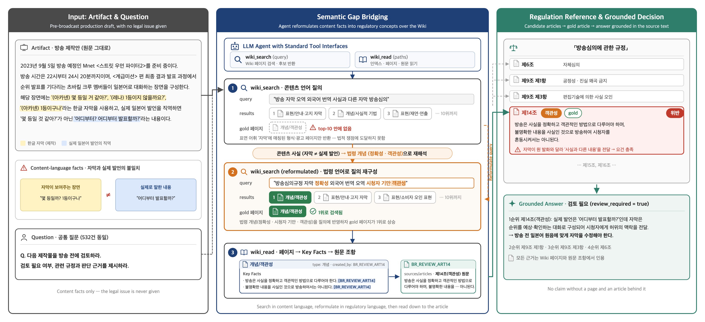

# 방송심의 위반 사례 기반 합성 벤치마크를 활용한 에이전트 규정 검색 평가

**Evaluating Agentic Regulatory Retrieval Using a Synthetic Benchmark from Broadcasting Violations** (HCLT 2026)

조소영 · 허윤석 — 서강대학교

HCLT 2026 논문의 평가 데이터, 규정 코퍼스, 프롬프트, 그리고 벤치마크 생성과 LLM-Wiki 실행 코드를 공개합니다.



## 과제

모델은 **방송 전 제작안**을 받습니다. 제작안은 콘텐츠 언어로만 쓰여 있고 법적 쟁점은 주어지지 않습니다. 모델은 방송 전에 검토해야 할 규정을 최대 10개까지 순위대로 반환합니다.

- **입력:** 제작안(`artifact`) + 고정된 검토 질문
- **출력:** 코퍼스의 규정 ID 순위 목록 (예: `BR_REVIEW_ART14`)
- **지표:** 규정 ID 정확 일치 Recall@1/5/10. 항·호 단위 정답에 상위 조문을 답하면 오답입니다.

어려움은 콘텐츠 언어("자막은 *몇 등일까?*인데 실제 발언은 *어디부터 발표할까?*")와 규정 언어("객관성", "사실의 정확성") 사이의 간극에서 나옵니다.

## 결과

단일 정답 400건, 단위 %.

| 방법 | R@1 | R@5 | R@10 |
|---|---:|---:|---:|
| BM25 + Luna | 11.25 | 15.50 | 16.75 |
| DenseRAG + Luna | 26.75 | 57.00 | 65.00 |
| GraphRAG-Local + reranking + Luna | 11.50 | 30.50 | 37.00 |
| **LLM-Wiki** | **38.25** | **63.75** | **66.75** |

시스템 단위 비교입니다. 방법마다 질문, 추론 설정, 탐색 예산이 다르며 [configs/paper.json](configs/paper.json)에 정리했습니다. 이 저장소에는 LLM-Wiki 코드만 포함하고 베이스라인 코드는 포함하지 않습니다.

## 구성

| 경로 | 내용 |
|---|---|
| [data/benchmark_400.jsonl](data/benchmark_400.jsonl) | 평가 사례 400건: `qa_id`, `domain`, `artifact`, `gold_rule_id` |
| [data/legal_corpus.jsonl](data/legal_corpus.jsonl) | 규정 3종, 226개 조문, 항·호·목 단위 1,040개 |
| [data/regulations/](data/regulations/) | 규정 원문 TXT |
| [data/sources.jsonl](data/sources.jsonl) | 사례별 의결 번호, PDF 쪽수, 공식 게시물 링크 (모델 입력 아님) |
| [prompts/](prompts/) | 제작안·해설 생성, LLM-Wiki 컴파일·질의 프롬프트 |
| [configs/](configs/) | 논문 실험 설정, 코퍼스·LLM-Wiki·데이터 생성 설정 |
| [src/](src/) | 코퍼스 구축, 벤치마크 생성, LLM-Wiki 컴파일러와 검색 에이전트 |

데이터 상세는 [data/README.md](data/README.md), 프롬프트 상세는 [prompts/README.md](prompts/README.md)에 있습니다.

### 벤치마크

| 도메인 | 사례 수 |
|---|---:|
| 방송프로그램 (`broadcast_program`) | 187 |
| 방송광고 (`broadcast_ad`) | 78 |
| 상품판매방송 (`product_sales`) | 135 |
| **합계** | **400** |

방송통신심의위원회의 공식 심의 의결을 바탕으로 만들었습니다. LLM이 각 위반 사례를 *방송 전* 제작안으로 다시 쓰면서 심의 결과, 인용 규정, 사후 판단을 걷어냈습니다. 정답은 해당 의결이 실제로 인용한 규정입니다.

전체 합성 데이터는 532건이며, 이 저장소는 정답 규정이 하나인 400건을 공개합니다. 논문의 주 평가에 쓴 집합이며 학습/평가 분할이 아닙니다.

### LLM-Wiki

*Retrieval as Reasoning: Self-Evolving Agent-Native Retrieval via LLM-Wiki* (arXiv 2605.25480)를 따릅니다. LLM이 226개 조문을 개념·상품·표현·주체 같은 개체 단위 Markdown 페이지로 컴파일합니다. 각 페이지에는 출처 규정 ID가 붙은 핵심 사실과 관련 페이지 링크가 들어갑니다. 질의 시 에이전트는 `wiki_search`, `wiki_read` 도구로 이 파일만 읽고 규정 ID 순위를 제출합니다.

## 설치

Python 3.10 이상이 필요합니다.

```bash
pip install -r requirements.txt
cp .env.example .env   # 모델을 호출하는 단계에만 OPENAI_API_KEY 필요
```

벤치마크 불러오기:

```python
import json
from pathlib import Path

cases = [json.loads(line) for line in Path("data/benchmark_400.jsonl").open(encoding="utf-8")]
question = json.loads(Path("configs/paper.json").read_text(encoding="utf-8"))["llmwiki"]["question"]

scenario = cases[0]["artifact"]   # 모델 입력
gold = cases[0]["gold_rule_id"]   # 채점에만 사용, 모델에 넣지 않음
```

테스트:

```bash
python -m unittest discover -s tests -t .
```

## 실행

논문의 모든 실행은 `gpt-5.6-luna`를 사용했습니다. 중간 파일, 생성된 Wiki, 실행 결과, API 캐시는 `outputs/`에 저장되며 저장소에서 추적하지 않습니다.

**1. 규정 코퍼스** — `data/regulations/`에서 `data/legal_corpus.jsonl`을 만듭니다. 결정적으로 동작하며 공개 파일과 동일한 결과가 나옵니다.

```bash
python -m src.corpus.build_legal_corpus --validate
```

**2. 벤치마크 생성** — 공식 의결 PDF → 합성 사례 532건 → 평가용 400건. 먼저 [configs/synthetic_data/decision_sources.yaml](configs/synthetic_data/decision_sources.yaml)에 있는 PDF를 받아 `data/decisions/`에 둡니다.

```bash
python -m src.synthetic_data.build_decision_chunks --validate
python -m src.synthetic_data.build_synthetic_data --check         # 모델 호출 없이 검증
python -m src.synthetic_data.build_synthetic_data --generate --model gpt-5.6-luna \
  --input-price-per-million <USD> --output-price-per-million <USD> --pricing-version <label>
python -m src.synthetic_data.export_benchmark                      # data/benchmark_400.jsonl, data/sources.jsonl 생성
```

LLM 생성은 매번 결과가 달라지므로 새로 실행하면 새 데이터셋이 만들어집니다. `export_benchmark --verify --input <synthetic_qa.jsonl>`로 데이터셋을 [data/manifest.json](data/manifest.json)의 해시와 대조할 수 있습니다.

**3. LLM-Wiki 컴파일** — 226개 조문에 최대 약 450회 호출합니다. 중단해도 이어서 실행됩니다.

```bash
python -m src.llmwiki.compile --check                 # 모델 호출 없이 검증
python -m src.llmwiki.compile --generate --confirm
```

**4. LLM-Wiki 평가** — 사례마다 에이전트를 한 번 실행합니다. 중단해도 이어서 실행되며, 끝나면 `metrics.md`에 지표를 기록합니다.

```bash
python -m src.llmwiki.qa.evaluate --check
python -m src.llmwiki.qa.evaluate --run-name smoke --case-id QA_F46C1A7BBDF7 --confirm
python -m src.llmwiki.qa.evaluate --run-name full --confirm
```

## 디렉터리 구조

```text
.
├── assets/              그림
├── configs/             paper.json, corpus.yaml, llmwiki.yaml, synthetic_data/
├── data/                벤치마크, 코퍼스, 규정 원문, 출처, manifest
├── prompts/             데이터 생성·LLM-Wiki 프롬프트
├── src/
│   ├── common.py
│   ├── corpus/          규정 TXT → legal_corpus.jsonl
│   ├── synthetic_data/  의결 PDF → 합성 사례 → 평가용 400건
│   └── llmwiki/         컴파일러(select → compile → validate → repair)와 qa/ 에이전트
└── tests/
```

## 한계

- 정답은 공식 의결이 인용한 규정입니다. 적용 가능한 모든 조항을 망라한 목록은 아닙니다.
- 제작안은 LLM이 재구성하고 자동 검증을 거친 것이며, 모든 사례를 전문가가 검토하지는 않았습니다.
- 규정 원문은 실험 시점의 스냅샷이며 현행 규정과 다를 수 있습니다.

## 인용

```bibtex
@inproceedings{cho2026regulatory,
  title     = {Evaluating Agentic Regulatory Retrieval Using a Synthetic Benchmark from Broadcasting Violations},
  author    = {Cho, Soyoung and Heo, Yoonseok},
  booktitle = {Proceedings of HCLT 2026},
  year      = {2026}
}
```

인용 정보는 [CITATION.cff](CITATION.cff)에도 있습니다.

## 라이선스

코드는 [MIT License](LICENSE)를 따릅니다. 규정 원문과 의결 정보는 방송통신심의위원회 공개 자료이며 이 저장소가 재허락하지 않습니다. 제작안은 LLM이 재구성한 것으로 위원회의 판단을 대신하지 않습니다.
